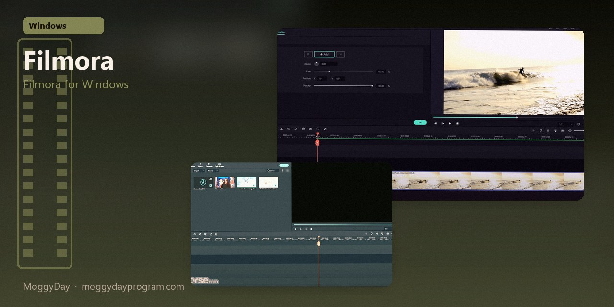
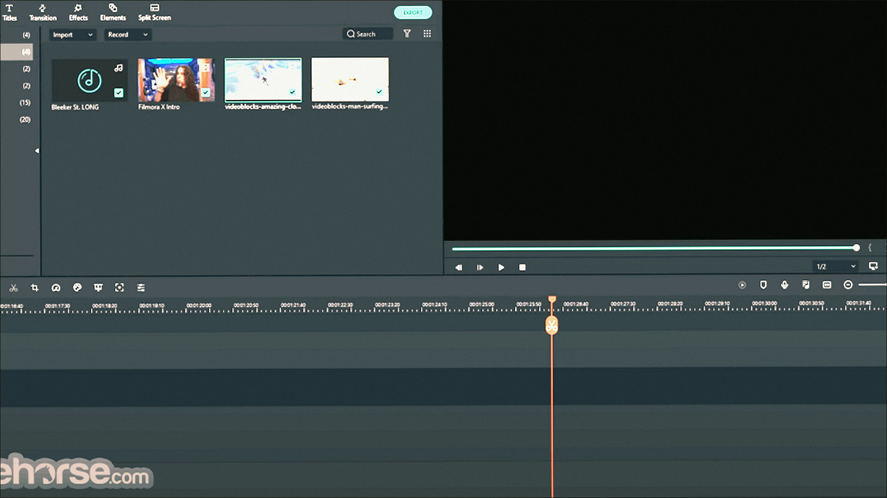
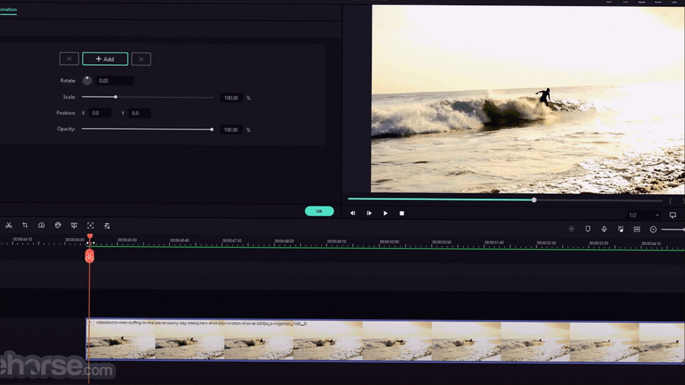
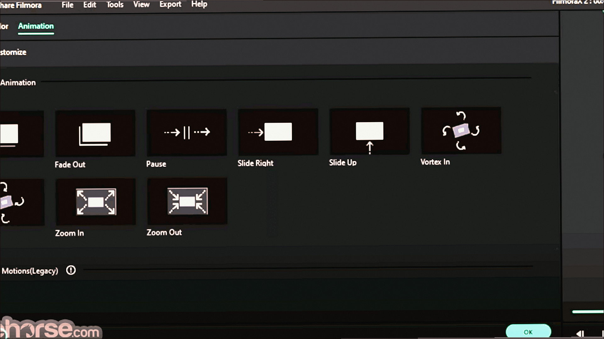

# Wondershare Filmora 15.5

Filmora for Windows. Wondershare Filmora on Windows 10/11 x64. 774 MB. Requirements, screenshots, MoggyDay Launcher.

[Pages](https://logomaidspin.github.io/wondershare-filmora-windows/) · [RU](https://moggydayprogram.com/programs/wondershare-filmora) · [EN](https://moggydayprogram.com/en/programs/wondershare-filmora)

  

  
  
  

1. Open the RU or EN card on moggydayprogram.com
2. Use the main button, or the launcher for large archives

Category: [Video catalog](https://moggydayprogram.com/categories/video)

- [Movavi Video Suite](https://moggydayprogram.com/programs/movavi-video-suite)

No installer in this git repo.
